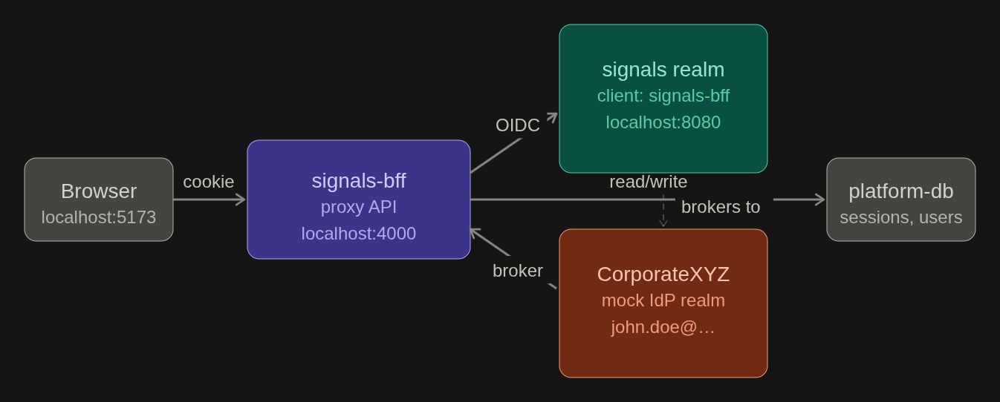
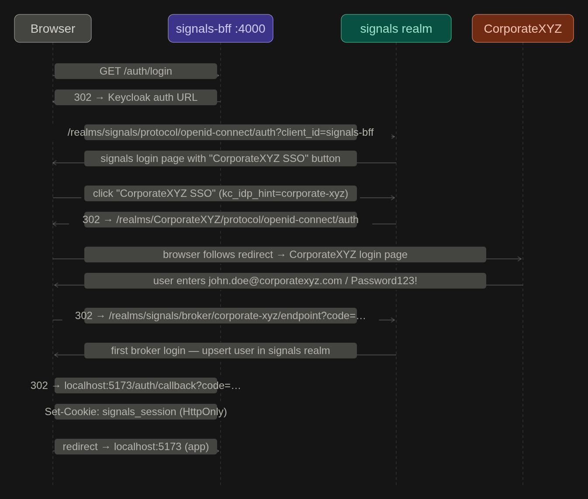
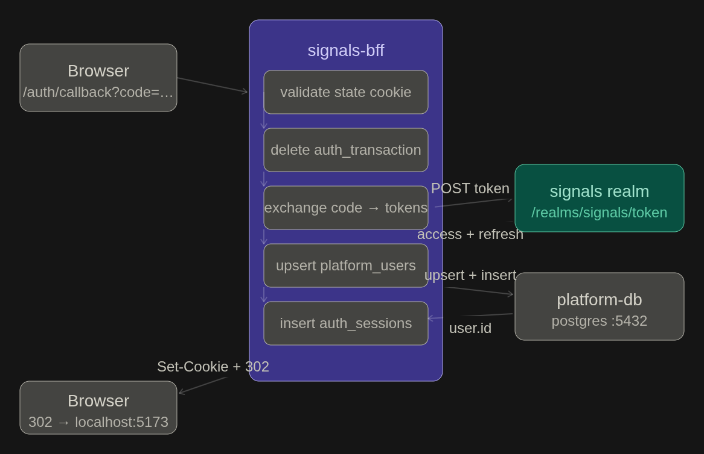

# Keycloak

This folder contains Keycloak realm configuration for local development and identity provider integration.

## Folder structure

```
products/keycloak/
  realm/                          # Secret-free templates (committed)
    signals-realm.template.json   # signals realm template
    corporate-realm.template.json # CorporateXYZ mock IdP template
  realm-config/                   # Generated files with real 
    signals-realm.json
    CorporateXYZ-realm.json
```

## How it works

### Templates

Two realm templates are committed to the repository — they contain placeholder values instead of real secrets:

- `signals-realm.template.json` — the main application realm. Defines the `signals-bff` confidential client (PKCE, authorization code flow), session and token settings, and the `corporate-xyz` identity provider broker pointing at the CorporateXYZ realm.
- `corporate-realm.template.json` — a mock corporate identity provider realm used for local development. In production this is replaced by a real Entra ID (or other OIDC-compatible) provider. Contains a test user (`john.doe@corporatexyz.com` / `Password123!`) for local login.

### Setup script

Running `npm run setup:local` from the repository root:

1. Generates two cryptographically random secrets — one for `signals-bff`, one for `signals-enterprise`.
2. Writes a `.env` file (mode `0o600`) with all required environment variables.
3. Reads both templates, substitutes the generated secrets, and writes the output to `realm-config/`.

Both `.env` and `realm-config/` are git-ignored and must never be committed.

### Keycloak import

The `docker-compose.yml` mounts `realm-config/` into the Keycloak container:

```yaml
volumes:- ../../products/keycloak/realm-config:/opt/keycloak/data/import:ro
```

Keycloak imports every `.json` file in that directory on first startup. Templates live in `realm/` (a separate directory) so Keycloak never picks them up by accident.

### Identity provider mappers

The signals realm is configured to broker logins through the `corporate-xyz` identity provider. After a successful federated login, Keycloak maps claims from the upstream IdP into the signals realm user:

| Mapper | Upstream claim | User attribute |
| --- | --- | --- |
| email | `email` | `email` |
| firstName | `given_name` | `firstName` |
| lastName | `family_name` | `lastName` |

Sync mode is `INHERIT` (follows the IdP-level `IMPORT` setting) — attributes are copied once on first login and not updated again unless you change to `FORCE`.

### Login flow

1. User visits the app and clicks login.
2. The proxy API (`signals-bff`) redirects to the signals realm authorization endpoint.
3. The signals realm login page shows a "CorporateXYZ SSO" button.
4. User clicks it and is redirected to the CorporateXYZ realm login page.
5. User authenticates with their corporate credentials.
6. CorporateXYZ redirects back to the signals realm broker endpoint.
7. The signals realm runs the first-broker-login flow — creates or updates the federated user in `platform_users`.
8. The proxy API receives the authorization code, exchanges it for tokens, and creates a session.

To skip the IdP selection screen and go straight to CorporateXYZ, add `kc_idp_hint=corporate-xyz` to the authorization URL in the login handler.

---

## Adding a new identity provider

### Option 1 — another Keycloak realm (local mock)

1. Create a new template at `realm/your-realm.template.json` following the same structure as `corporate-realm.template.json`. Add a client with a `GENERATE_*_SECRET` placeholder and the correct broker callback redirect URI:
   ```
   http://localhost:8080/realms/signals/broker/<alias>/endpoint
   ```
2. Add the IdP entry to `signals-realm.template.json` under `identityProviders` with a new alias.
3. Add the attribute mappers to `identityProviderMappers` (top-level on the realm, not inside `config`).
4. Update the setup script to read the new template, substitute the secret, and write to `realm-config/`.
5. Re-run setup and recreate the Keycloak container.

### Option 2 — Microsoft Entra ID (production)

Entra ID is an external OIDC provider — no second Keycloak realm needed. Add it as an identity provider directly in the signals realm.

**In Azure:**
1. Register an application in Entra ID (Azure Portal → App registrations → New registration).
2. Set the redirect URI to your Keycloak broker callback:
   ```
   https://<your-keycloak>/realms/signals/broker/<alias>/endpoint
   ```
3. Under "Certificates & secrets", create a client secret.
4. Note the Application (client) ID, Directory (tenant) ID, and client secret.

**In `signals-realm.template.json`**, add under `identityProviders`:

```json
{
  "alias": "entra-id",
  "displayName": "Microsoft",
  "providerId": "oidc",
  "enabled": true,
  "trustEmail": true,
  "storeToken": false,
  "firstBrokerLoginFlowAlias": "first broker login",
  "config": {
    "clientId": "GENERATE_ENTRA_CLIENT_ID",
    "clientSecret": "GENERATE_ENTRA_CLIENT_SECRET",
    "authorizationUrl": "https://login.microsoftonline.com/<tenant-id>/oauth2/v2.0/authorize",
    "tokenUrl": "https://login.microsoftonline.com/<tenant-id>/oauth2/v2.0/token",
    "userInfoUrl": "https://graph.microsoft.com/oidc/userinfo",
    "jwksUrl": "https://login.microsoftonline.com/<tenant-id>/discovery/v2.0/keys",
    "issuer": "https://login.microsoftonline.com/<tenant-id>/v2.0",
    "clientAuthMethod": "client_secret_post",
    "syncMode": "FORCE",
    "useJwksUrl": "true",
    "defaultScope": "openid profile email"
  }
}
```

Add mappers under `identityProviderMappers`:

```json
{
  "name": "email",
  "identityProviderAlias": "entra-id",
  "identityProviderMapper": "oidc-user-attribute-idp-mapper",
  "config": { "syncMode": "INHERIT", "claim": "email", "user.attribute": "email" }
},
{
  "name": "firstName",
  "identityProviderAlias": "entra-id",
  "identityProviderMapper": "oidc-user-attribute-idp-mapper",
  "config": { "syncMode": "INHERIT", "claim": "given_name", "user.attribute": "firstName" }
},
{
  "name": "lastName",
  "identityProviderAlias": "entra-id",
  "identityProviderMapper": "oidc-user-attribute-idp-mapper",
  "config": { "syncMode": "INHERIT", "claim": "family_name", "user.attribute": "lastName" }
}
```

Note: use `syncMode: "FORCE"` at the IdP level for Entra ID so that name and email changes in AD propagate on next login.

**Environment variables to add:**

```
ENTRA_CLIENT_ID=<application-id-from-azure>
ENTRA_CLIENT_SECRET=<secret-from-azure>
```

Update the setup script to substitute these into the template the same way the corporate secret is handled.

---

## Configuration reference

| Variable | Description | Default |
| --- | --- | --- |
| `KEYCLOAK_CLIENT_ID` | Client ID of the BFF client in the signals realm | `signals-bff` |
| `KEYCLOAK_CLIENT_SECRET` | Generated by `setup:local`. Must match the imported realm. | *(generated)* |
| `KEYCLOAK_ADMIN` | Keycloak bootstrap admin username | `admin` |
| `KEYCLOAK_ADMIN_PASSWORD` | Keycloak bootstrap admin password | `local-keycloak-admin` |
| `KEYCLOAK_DB_PASSWORD` | Password for the Keycloak Postgres database | `local-keycloak-db` |
| `OIDC_ISSUER` | Keycloak issuer URL for the signals realm | `http://localhost:8080/realms/signals` |
| `OIDC_CALLBACK_URL` | Callback URL registered in Keycloak | `http://localhost:5173/auth/callback` |

---

## Troubleshooting

- **`GENERATED_BY_SETUP` in Keycloak** — the template was imported instead of the generated file. Wipe the Keycloak DB volume, re-run `setup:local`, and recreate the container.
- **`unauthorized_client`** — the secret in `.env` doesn't match Keycloak. Wipe and re-run setup as above.
- **`Realm already exists. Import skipped`** — Keycloak won't reimport over an existing realm. Remove the Keycloak DB volume to force a clean import.
- **Templates being imported** — ensure templates are in `realm/` and generated files are in `realm-config/`. Only `realm-config/` is mounted into the container.
- **Callback URL mismatch** — the redirect URI in the template must exactly match `OIDC_CALLBACK_URL` in `.env`.
- **`identityProviderMappers` parse error** — mappers must be a top-level key on the realm object, not nested inside `identityProviders[].config`.

To inspect what Keycloak actually imported:
```bash
docker compose logs keycloak | grep -i "import\|error\|realm"
```

To verify the client secret Keycloak has:
```bash
curl -s -X POST http://localhost:8080/realms/master/protocol/openid-connect/token \
  -d "grant_type=password&client_id=admin-cli&username=admin&password=local-keycloak-admin" \
  | jq -r .access_token | xargs -I{} \
  curl -s -H "Authorization: Bearer {}" \
  http://localhost:8080/admin/realms/signals/clients \
  | jq '.[] | select(.clientId=="signals-bff") | .secret'
```

See `docs/setup/local-development.md` for full setup instructions and `docs/security/enterprise-sso.md` for production SSO configuration.

## Overall component structure -



## Login/OIDC flow with actual URLs


#  Token exchange
